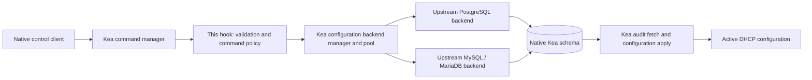

# Architecture and roadmap

## Integration boundary

The project is a Linux shared-library hook loaded by unmodified Kea. Commands
receive native `Element` data through `CalloutHandle`, validate their own request
contract, and return responses through `isc::config::createAnswer`. Read-only
`cb-subnet4-list` calls the daemon's existing configuration backend
pool. Kea owns SQL factories, connections, schema enforcement, audit records,
transactions, configuration fetching, and runtime activation.

Both subnet commands use the native DHCPv4 pool and sole configured backend's
type. PostgreSQL and MariaDB reads and minimal subnet writes are runtime-verified
with the same hook code. SQL persistence and native pull/reload activation are
separate operations; the hook never initiates activation.

## Minimal implementation

`src/diagnostic.cc` contains four exported C entry points and three private command
callouts. `load` checks the process and family, then registers
`db-commands-diagnostic`, `cb-subnet4-list`, and `cb-subnet4-set`.
`version` returns the installed header's exact framework
version. `unload` logs teardown; Kea owns callout deregistration. The stateless
hook declares multi-threading compatibility for synchronous main-thread command
execution, matching the native SQL hooks' assumption. Mutation tests pass with
packet multithreading enabled and disabled. Independent external writers require
coordination; no public upstream transaction spans the preflight reads and write.

The command resolves `ConfigBackendDHCPv4Mgr::instance().getPool()` at invocation
time and holds no pool across reloads. A missing configuration backend is not an
error for this diagnostic: upstream can construct an empty pool. The response
therefore explicitly says database connectivity was not tested. Exceptions are
contained at hook boundaries; database exception text is not returned because it
can contain connection parameters. The hook uses Kea logging and an original
small message dictionary, with no message-code generator dependency.

The subnet command selects the sole configured backend's type and Kea's active server-tag
semantics (`ALL` by default, `ONE(tag)` otherwise), then calls
`getAllSubnets4` and serializes each object with `Subnet4::toElement`.
Missing matching backends and native exceptions return a generic error; connected
empty results are successful. Multiple configured backends are rejected because
the native read pool returns the first nonempty collection rather than merging
databases. Shared-network subnets are rejected because flat native serialization
omits membership and inherited settings. Kea owns reconnect callbacks; no hook
retry loop is introduced. See [the command contract](postgresql.md) and
[verified upstream behavior](backend-behavior.md).

The set command validates an explicit tag and minimal native subnet, reads by
ID and prefix using `ANY` to detect hidden conflicts, refuses richer existing
objects or association changes, constructs optional native `Pool4` ranges,
preserves basic stored pools when omitted, and delegates one write to
`createUpdateSubnet4`. Native drivers own transaction rollback and audit. The
hook neither issues SQL nor constructs a private backend. Write failures are
never retried; uncertain commit outcomes require reconciliation. See the
[exact contract and consistency limits](commands.md).

The build uses upstream `kea.pc` metadata and shared Kea libraries, either from a
matching installation or Meson's uninstalled build-tree metadata. A configure
probe compiles and links the manager accessor. `-z defs` also rejects unresolved
references when linking the module. Hidden visibility leaves only required
entry points exported by project source. Both checks supplement, but cannot
replace, a real daemon load. Never statically embed Kea or bundle alternate
versions of its dependencies.

There is no public project header yet: one source file has no reusable project API.
There is no custom `cmake/` module because upstream provides pkg-config metadata.
These directories should appear only when an actual component needs them.

## Command invariants

- Resolve the current family-specific pool for each operation. Do not retain
  pointers through configuration reloads or initialize a separate manager.
- Validate the complete request before calling a mutating API. Use upstream
  parsers/model objects where their context and validation contracts are usable;
  verify that construction alone does not bypass server-level validation.
- Require an unambiguous backend and explicit legal server-selector semantics.
  Never silently select the first database or fan out a write.
- Delegate one mutation to one upstream pool method. Do not expose batch atomicity
  without a supporting public transaction contract.
- Separate committed database state from active server state. Use the supported
  pull/apply path; do not invoke internal server objects by unsafe casts or mutate
  `CfgMgr` directly.
- Do not retry a write after an uncertain connection failure until state is
  reconciled. A failed activation after a confirmed commit is a different outcome.
- Do not register commercial command names until public contracts, collision
  handling, and compatibility tests exist. The prototype's distinct diagnostic
  name avoids implying that compatibility already exists.

## Tests and release gates

`tests/test_transport.py` exercises actual local socket framing, UTF-8
fragmentation, truncation, response shape, and response size limits. It needs only
Python. It does not test C++ or the Kea ABI.

The CMake compile/link probe and module link test headers and symbol resolution.
`tests/smoke.py` then uses a real matching `kea-dhcp4`, a temporary configuration,
memfile with persistence disabled, no listening DHCP interfaces, and a loopback
HTTP control channel with fresh file-based Basic credentials. It runs `-T` (which
loads hooks), starts the server, checks command registration and response data,
rejects invalid arguments, removes/re-adds the
hook through configuration reloads, and shuts down. It repeats with threading
disabled and enabled. PID/log lock files stay in the test directory. The test
does not need database servers, DHCP traffic, or packet socket privileges.

The fixture binds only to loopback and uses an OS-selected available port. A port
collision before Kea binds fails the test. Use `--work-dir` within the checkout
and do not point tests at a running production server. Normal Kea security checks
remain enabled. The HTTP channel avoids the Unix-socket limitations of Windows
mounted filesystems; Linux filesystem builds are still preferred for performance.

GitHub Actions separates fast quality checks from a clean Kea 3.2.1 build and
strict six-test integration gate. CI execution remains unverified; writing the
workflow does not establish compatibility. See [the build guide](reproducible-builds.md).

## Implementation roadmap

1. **Diagnostic scaffold.** Kea 3.2.1 build and lifecycle verified; Kea 3.0.4
   remains source-assessed only.
2. **Native PostgreSQL read integration — verified on Kea 3.2.1.** Implemented
   `cb-subnet4-list` and an isolated real-PostgreSQL harness covering empty, tagged, unavailable and
   nonmutating reads in both threading modes. Verification results are recorded
   in [development](development.md#milestone-2-verification-record).
   MySQL/MariaDB and DHCPv6 are outside this milestone.
3. **Read hardening — PostgreSQL verified; MySQL initially blocked.**
   Complex pools/options/timers/classes, associations, empty selections,
   multiple-backend rejection, shared-network rejection, duplicate schema IDs,
   disconnection and automatic native recovery pass in both threading modes.
   At Milestone 3 completion the opt-in MariaDB harness lacked runtime
   prerequisites; Milestone 3.5 resolves that blocker. Native SELECT-only startup
   remains a limitation.
   See [Milestone 3 results](development.md#milestone-3-verification-record).
4. **Milestone 3.5: native MariaDB read parity.** The matching unmodified MySQL
   backend builds and runs against private MariaDB 10.11 instances. Complex reads,
   tags, ambiguity rejection, nonmutation, native recovery and retry exhaustion
   are tested in both threading modes. Native initialization requires schema-scoped
   SELECT/INSERT/UPDATE/DELETE grants; EXECUTE is unnecessary for these reads.
   PostgreSQL regression retains SELECT-only credentials. See
   [the verification record](development.md#milestone-35-verification-record).
   Oracle MySQL needs separate bootstrap support and runtime testing. Shared-network
   reads still require a complete serialization contract.
5. **Milestone 4: minimal native subnet create/update — verified.**
   `cb-subnet4-set` persists ID, prefix, lifetime and one explicit association on
   both engines. Validation, conflicts, richer-object rejection, late-failure
   all-table rollback, audit/timestamps, outage errors, native pull/reload and
   restart persistence pass in both threading modes. Native transactions protect
   one write; external-writer preflight races and commit-boundary uncertainty
   remain explicit limitations. No packet allocation or pull-failure proof is
   claimed. See [the mutation contract](commands.md).
6. **Milestone 5: basic DHCPv4 pools and real allocation — verified.**
   Optional explicit start/end ranges use native pool construction and subnet
   validation. Omission preserves existing basic pools; an explicit list replaces
   them, including `[]`. The shared SQL tests cover persistence and rollback;
   opt-in namespace tests cover real DORA, lease recording, activation failure,
   replacement/reload and restart. All six CTests, including twelve real DORA
   exchanges, passed. See [the verification record](pools.md).
7. **Milestone 6: reproducible builds and development quality.** Pin and verify
   upstream source, build in a fresh prefix, enforce formatting/lint and strict
   integration gates, and inspect installed shared-library exports/dependencies.
   See [procedures and execution status](reproducible-builds.md).
8. **Expand by tested object family.** Add deletion, shared networks, options,
   option definitions, globals, classes, and server associations only as supported
   by exact upstream APIs. Evaluate documented `cb_cmds` compatibility per command.
9. **Release discipline.** Maintain exact-release build artifacts and regression
   gates; add packaging only after dependency and ABI constraints are demonstrated.

The recommended next milestone is supported-version ABI/install verification and
recovery/scale testing of the existing subnet and pool contract. Add another
object family only after the existing acceptance gates pass.
Establish an explicit deployment policy for coordinating writers before
production writes; concurrent external writers require stronger upstream
transaction or locking support.
