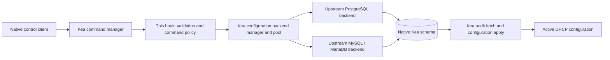

# Architecture and roadmap

## Integration boundary

The project is a Linux shared-library hook loaded by unmodified Kea. Commands
receive native `Element` data through `CalloutHandle`, validate their own request
contract, and return responses through `isc::config::createAnswer`. Future
configuration commands will call the daemon's existing configuration backend
pool. Kea owns SQL factories, connections, schema enforcement, audit records,
transactions, configuration fetching, and runtime activation.

The diagram shows the intended full path. The current hook stops after obtaining
the DHCPv4 pool. It neither selects a backend nor executes SQL.

## Minimal implementation

`src/diagnostic.cc` contains four exported C entry points and one private command
callout. `load` checks the process and family, then registers
`db-commands-diagnostic`. `version` returns the installed header's exact framework
version. `unload` logs teardown; Kea owns callout deregistration. The stateless
diagnostic declares multi-threading compatibility; future mutations require a
separate concurrency review before retaining this declaration.

The command resolves `ConfigBackendDHCPv4Mgr::instance().getPool()` at invocation
time and holds no pool across reloads. A missing configuration backend is not an
error for this diagnostic: upstream can construct an empty pool. The response
therefore explicitly says database connectivity was not tested. Exceptions are
contained at hook boundaries; database exception text is not returned because it
can contain connection parameters. The hook uses Kea logging and an original
small message dictionary, with no message-code generator dependency.

The build uses upstream `kea.pc` metadata and shared Kea libraries, either from a
matching installation or Meson's uninstalled build-tree metadata. A configure
probe compiles and links the manager accessor. `-z defs` also rejects unresolved
references when linking the module. Hidden visibility leaves only required
entry points exported by project source. Both checks supplement, but cannot
replace, a real daemon load. Never statically embed Kea or bundle alternate
versions of its dependencies.

There is no public project header yet: one source file has no reusable project API.
There is no custom `cmake/` module because upstream provides pkg-config metadata.
These directories should appear only when an actual component needs them.

## Future command invariants

- Resolve the current family-specific pool for each operation. Do not retain
  pointers through configuration reloads or initialize a separate manager.
- Validate the complete request before calling a mutating API. Use upstream
  parsers/model objects where their context and validation contracts are usable;
  verify that construction alone does not bypass server-level validation.
- Require an unambiguous backend and explicit legal server-selector semantics.
  Never silently select the first database or fan out a write.
- Delegate one mutation to one upstream pool method. Do not expose batch atomicity
  without a supporting public transaction contract.
- Separate committed database state from active server state. Use the supported
  pull/apply path; do not invoke internal server objects by unsafe casts or mutate
  `CfgMgr` directly.
- Do not retry a write after an uncertain connection failure until state is
  reconciled. A failed activation after a confirmed commit is a different outcome.
- Do not register commercial command names until public contracts, collision
  handling, and compatibility tests exist. The prototype's distinct diagnostic
  name avoids implying that compatibility already exists.

## Tests and release gates

`tests/test_transport.py` exercises actual local socket framing, UTF-8
fragmentation, truncation, response shape, and response size limits. It needs only
Python. It does not test C++ or the Kea ABI.

The CMake compile/link probe and module link test headers and symbol resolution.
`tests/smoke.py` then uses a real matching `kea-dhcp4`, a temporary configuration,
memfile with persistence disabled, no listening DHCP interfaces, and a loopback
HTTP control channel with fresh file-based Basic credentials. It runs `-T` (which
loads hooks), starts the server, checks command registration and response data,
rejects invalid arguments, removes/re-adds the
hook through configuration reloads, and shuts down. It repeats with threading
disabled and enabled. PID/log lock files stay in the test directory. The test
does not need database servers, DHCP traffic, or packet socket privileges.

The fixture binds only to loopback and uses an OS-selected available port. A port
collision before Kea binds fails the test. Use `--work-dir` within the checkout
and do not point tests at a running production server. Normal Kea security checks
remain enabled. The HTTP channel avoids the Unix-socket limitations of Windows
mounted filesystems; Linux filesystem builds are still preferred for performance.

The GitHub Actions matrix builds each source-assessed Kea release independently,
builds the hook, and runs CTest. It is a proposed execution path until a real CI
run succeeds; writing the workflow does not establish compatibility.

## Implementation roadmap

1. **Complete the release matrix on 3.0.4.** The 3.2.1 diagnostic lifecycle has
   passed in Debian WSL; 3.0.4 remains source-assessed only. Record compiler, Kea
   build options, exact headers/runtime, exported symbols, dynamic dependencies, and
   successful lifecycle tests. Stop and document any visibility or ABI blocker.
2. **Read-only SQL integration.** Use disposable PostgreSQL and MySQL/MariaDB
   databases with the matching `kea-admin` schema and upstream SQL hooks. Test
   absent, disconnected, ambiguous, and tagged backends; verify native pull and
   effective configuration. Add DHCPv6 manager access and load guards/tests.
3. **One carefully specified mutation.** Select a single object operation such as
   subnet create/update only after parser and selector policy is reviewed. Specify
   the public JSON contract, validation, transaction boundary, audit visibility,
   conflict/error responses, and explicit activation outcomes. Exercise rollback,
   connection loss, concurrent writers, and pull failure on both SQL engines.
4. **Expand by tested object family.** Add deletion, shared networks, options,
   option definitions, globals, classes, and server associations only as supported
   by exact upstream APIs. Evaluate documented `cb_cmds` compatibility per command.
5. **Release discipline.** Maintain exact-release build artifacts and regression
   gates; add packaging only after dependency and ABI constraints are demonstrated.

The next milestone is completing step 1 on 3.0.4, followed by read-only SQL
integration. Production database writes remain a later gate.
